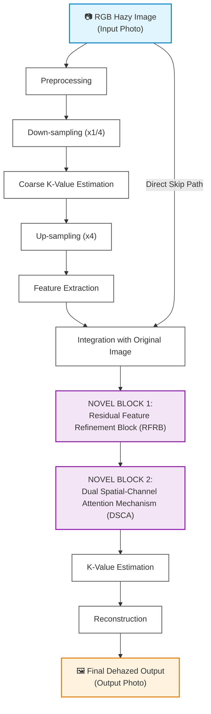

# System Block Diagram: DAM-RFRNet Architecture (Corrected Connections)

This document presents the corrected System Block Diagram for **DAM-RFRNet Architecture**:
- **Fixed Connection**: The output of `Feature Extraction` connects **ONLY** to `Integration with Original Image` (stray arrow to `Final Dehazed Output` removed).

---

## 1. Corrected System Flowchart

```
                                  +-----------------------+
                                  |    Preprocessing      |
                                  +-----------+-----------+
                                              |
                                              v
                                  +-----------------------+
                                  | Down-sampling (x1/4)  |
                                  +-----------+-----------+
                                              |
                                              v
                                  +-----------------------+
                                  | Coarse K-Value        |
                                  | Estimation            |
                                  +-----------+-----------+
                                              |
                                              v
                                  +-----------------------+
                                  |  Up-sampling (x4)     |
                                  +-----------+-----------+
                                              |
                                              v
                                  +-----------------------+
                                  |  Feature Extraction   |
                                  +-----------+-----------+
                                              |
+-------------------+                         v (ONLY ONE ARROW)
|   RGB Hazy Image  |-------------> +-------------------------------+
|     I(x)          |               | Integration with Original     |
+-------------------+               | Image                         |
                                    +---------------+---------------+
                                                    |
                                                    v
                                    +-------------------------------+
                                    |  NOVEL BLOCK 1:               |
                                    |  Residual Feature Refinement  |
                                    |  Block (RFRB)                 |
                                    +---------------+---------------+
                                                    |
                                                    v
                                    +-------------------------------+
                                    |  NOVEL BLOCK 2:               |
                                    |  Dual Spatial-Channel         |
                                    |  Attention Mechanism (DSCA)   |
                                    +---------------+---------------+
                                                    |
                                                    v
                                    +-------------------------------+
                                    |  K-Value Estimation           |
                                    +---------------+---------------+
                                                    |
                                                    v
                                    +-------------------------------+
                                    |  Reconstruction               |
                                    |  (using physical model)       |
                                    +---------------+---------------+
                                                    |
                                                    v
                                    +-------------------------------+
                                    |  Final Dehazed Output J(x)    |
                                    +-------------------------------+
```

---

## 2. Interactive Mermaid Flowchart



---

## 3. Summary of Fixes
1. **Removed Stray Arrow**: `Feature Extraction` output arrow points **exclusively** down into `Integration with Original Image`.
2. **Correct Processing Path**: Ensures features are integrated before being passed to **RFRB** and **DSCA**.
