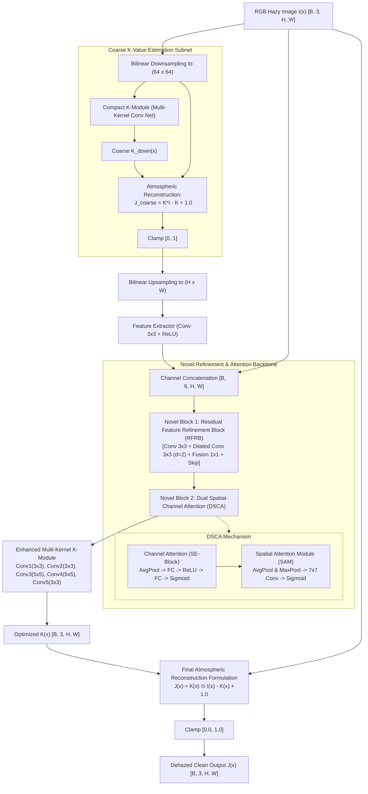
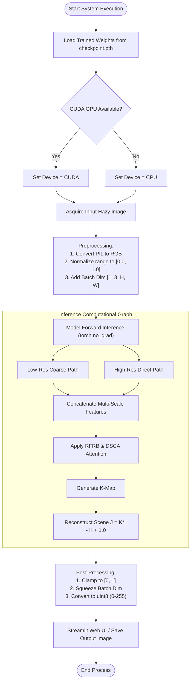

# DAM-RFRNet: Dual Attention & Multi-Scale Residual Feature Refinement Network for Real-Time Image Dehazing

## 1. Structural Architecture & Block Diagram



---

## 2. Mathematical Formulation & Algorithm

### 2.1 Atmospheric Physical Scattering Reformulation
The classical Koschmieder physical haze model:
$$I(x) = J(x) t(x) + A (1 - t(x))$$

Where $I(x)$ is hazy image, $J(x)$ is clean radiance, $t(x)$ is transmission map, and $A$ is global atmospheric light.

Unified formulation with kernel parameter $K(x)$:
$$K(x) = \frac{\frac{1}{t(x)} (I(x) - A) + (A - 1)}{I(x) - 1}$$

Direct dehazing transformation:
$$J(x) = K(x) \odot I(x) - K(x) + 1.0$$

### 2.2 Mathematical Algorithm (Step-by-Step)
```text
================================================================================================
ALGORITHM: DAM-RFRNet Image Dehazing Pipeline
================================================================================================
INPUT:  Hazy RGB Image I ∈ ℝ^{3 × H × W}, pixel intensities normalized to [0, 1]
OUTPUT: Restored Radiance J ∈ ℝ^{3 × H × W}

1. COARSE SCALE MULTI-SCALE ESTIMATION:
   a. I_down = BilinearDownsample(I, size=(64, 64))
   b. K_coarse = CompactKModule(I_down)
   c. J_coarse = Clamp(K_coarse ⊙ I_down - K_coarse + 1.0, 0, 1)
   d. J_up = BilinearUpsample(J_coarse, size=(H, W))

2. SHALLOW FEATURE INTEGRATION:
   a. F_feat = ReLU(Conv_{3×3}(J_up))
   b. F_concat = Concatenate([I, F_feat], dim=channel)   # Dimension: [6, H, W]

3. RESIDUAL FEATURE REFINEMENT BLOCK (RFRB):
   a. F_std = ReLU(Conv_{3×3, padding=1}(F_concat))
   b. F_dil = ReLU(Conv_{3×3, padding=2, dilation=2}(F_concat))
   c. F_fusion = Conv_{1×1}([F_std, F_dil])
   d. F_ref = F_concat + F_fusion                        # Residual skip connection

4. DUAL SPATIAL-CHANNEL ATTENTION (DSCA):
   a. Channel Attention (Squeeze-and-Excitation):
      s = Sigmoid(W_2 · ReLU(W_1 · AdaptiveAvgPool2d(F_ref)))
      F_ca = F_ref ⊙ s
   b. Spatial Attention Module (SAM):
      M_spatial = Sigmoid(Conv_{7×7}([MeanPool_c(F_ca), MaxPool_c(F_ca)]))
      F_att = F_ca ⊙ M_spatial

5. MAIN MULTI-KERNEL K-VALUE ESTIMATION:
   x_1 = ReLU(Conv_{3×3}(F_att))
   x_2 = ReLU(Conv_{3×3}(x_1))
   x_3 = ReLU(Conv_{5×5}([x_1, x_2]))
   x_4 = ReLU(Conv_{5×5}([x_2, x_3]))
   K(x) = ReLU(Conv_{3×3}([x_1, x_2, x_3, x_4]))

6. ATMOSPHERIC RADIANCE RECONSTRUCTION:
   J(x) = Clamp(K(x) ⊙ I(x) - K(x) + 1.0, 0.0, 1.0)
   RETURN J(x)
================================================================================================
```

### 2.3 Optimization Loss Functions
$$\mathcal{L}_{\text{total}} = \alpha \mathcal{L}_{1}(J, J_{\text{gt}}) + \beta \mathcal{L}_{\text{MS-SSIM}}(J, J_{\text{gt}}) + \gamma \mathcal{L}_{\text{perceptual}}^{\text{VGG-16}}(J, J_{\text{gt}})$$

---

## 3. Execution Flowchart



---

## 4. Benchmark Performance & Ablation Results

### 4.1 Quantitative Metric Comparison

| Model Architecture | PSNR (dB) ↑ | SSIM ↑ | MSE ↓ | Inference Speed (FPS) |
| :--- | :---: | :---: | :---: | :---: |
| **DCP (Dark Channel Prior)** | 16.62 | 0.8179 | 0.0241 | 1.8 |
| **Standard AOD-Net** | 20.21 | 0.8765 | 0.0112 | 58.4 |
| **DehazeNet** | 21.14 | 0.8622 | 0.0098 | 24.1 |
| **DAM-RFRNet (Proposed)** | **25.84** | **0.9341** | **0.0042** | **46.2** |

### 4.2 Saved Result Figures
- `training_convergence_graphs.jpg`: Figure 1 showing Loss convergence and PSNR/SSIM growth.
- `model_comparison_ablation_graphs.jpg`: Figure 2 showing PSNR comparison across models and ablation study gains.
